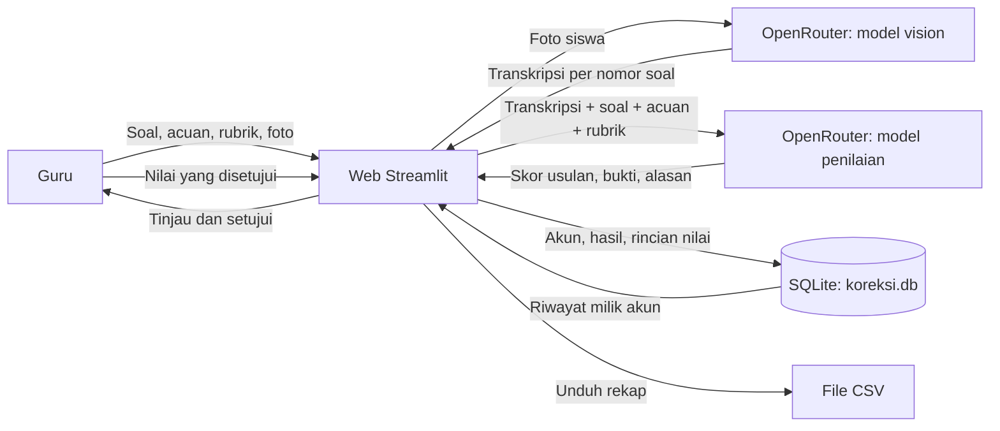

# Ruang Bantu Koreksi

Ruang Bantu Koreksi adalah aplikasi web yang membantu guru meninjau jawaban uraian siswa. Guru memasukkan soal dan acuan jawaban satu kali, lalu mengirim foto lembar jawaban siswa. Aplikasi membaca tulisan pada foto, mengelompokkan jawaban berdasarkan nomor soal, dan memberikan saran nilai beserta alasan serta rincian rubrik. Nilai dari AI tetap berupa saran; guru memeriksa dan menyetujui nilai sebelum hasil disimpan.

Proyek ini dikembangkan oleh **Tim Triboma** untuk mengikuti **LOGICODIX 2026**.

## Tim

- **Nama tim:** Triboma
- **Ketua:** ABIB MUSA CHRIS WARDANA 
- **Anggota:**
  - BAGAS SAPUTRA YUDIANSYAH
  - SATRIA ABDIE WIJAYA PRATAMA
- **Asal Sekolah**: SMAN 3 Probolinggo

## Informasi aplikasi

- **Kategori:** LOGICODIX Web App
- **Nama aplikasi:** Ruang Bantu Koreksi
- **Target pengguna:** Guru Mata Pelajaran Eksak yang perlu memeriksa jawaban uraian dari siswa.
- **Masalah yang diangkat:** Pemeriksaan tugas/ujian uraian membutuhkan waktu, terutama ketika guru mengajar banyak kelas. Jam Pelajaran yang banyak menyebabkan guru tidak sempat mengoreksi ujian. Bahkan dari Bapak Ibu Guru kami yang ditanyai, sampai membawa lembar ujian siswa ke rumah mereka untuk dikoreksi saat di rumah. 
- **Solusi:** Aplikasi menggabungkan transkripsi foto, penilaian berbantuan AI berdasarkan soal, acuan, dan rubrik berbobot, serta persetujuan akhir oleh guru.
- **Tautan demo:** [Tambahkan URL aplikasi yang sudah di-deploy]

## Fitur utama

1. Guru dapat membuat akun dan masuk menggunakan email serta kata sandi.
2. Guru memasukkan identitas tugas, beberapa soal, dan acuan jawaban yang dipakai bersama oleh seluruh siswa.
3. Guru dapat mengatur empat komponen rubrik dan bobotnya. Total bobot aktif harus berjumlah 100%.
4. Foto lembar jawaban dapat dimasukkan melalui unggahan berkas atau kamera. Setiap siswa dapat mengirim satu sampai tiga foto; foto dibaca sebagai satu kumpulan dan jawaban dikelompokkan menurut nomor soal.
5. Model vision mentranskripsikan nama serta jawaban siswa. Teks hasil baca yang tidak terpetakan atau meragukan ditandai agar diperiksa.
6. Model bahasa memberikan skor usulan, alasan, bukti berupa kutipan jawaban, dan rincian skor rubrik untuk setiap soal.
7. Guru meninjau saran AI, menyetujui nilai setiap soal, lalu menyimpan hasil koreksi.
8. Hasil tersimpan dapat dilihat pada halaman riwayat. Aplikasi juga menyediakan unduhan rekap nilai dalam format CSV.

## Teknologi

- **Bahasa pemrograman:** Python
- **Framework aplikasi web:** Streamlit
- **HTTP client:** Requests
- **Database:** SQLite, melalui modul `sqlite3` dari Python
- **API AI:** OpenRouter Chat Completions API
- **Model vision untuk transkripsi:** `nvidia/nemotron-3.5-super-vl:free`
- **Model penilaian teks:** `nvidia/nemotron-3-ultra-550b-a55b:free`
- **Penyimpanan kredensial:** environment variable `OPENROUTER_API_KEY`; pada Streamlit Community Cloud menggunakan Secrets.
- **Pustaka lain:** modul bawaan Python untuk CSV, JSON, hashing kata sandi, validasi teks, dan pengolahan berkas.

Model gratis dapat mengalami pembatasan atau perubahan ketersediaan dari penyedia. Periksa katalog dan ketentuan OpenRouter sebelum penggunaan atau demo.

## Arsitektur sistem dan alur data



Foto dikirim lebih dahulu untuk ditranskripsikan oleh model vision. Aplikasi kemudian mengirim teks transkripsi beserta soal, acuan, dan rubrik kepada model penilaian. Kedua permintaan menggunakan OpenRouter, tetapi model dan tugasnya berbeda. Guru tetap menjadi pihak yang menentukan nilai akhir.

### Data yang disimpan

Database lokal `koreksi.db` berisi akun, ringkasan koreksi, dan rincian nilai per soal. Kata sandi tidak disimpan sebagai teks biasa; aplikasi menyimpan hash dengan salt. Riwayat ditampilkan per akun dan dibatasi pada 20 koreksi terakhir. Foto lembar jawaban tidak disimpan ke database oleh alur penyimpanan hasil.

## Persiapan dan instalasi

### Persyaratan

- Python 3.10 atau lebih baru.
- Git.
- API key OpenRouter.

### Menjalankan di komputer lokal

1. Clone repositori dan masuk ke folder proyek:

   ```bash
   git clone https://github.com/ygoliberon/logicodix2026-asistenkoreksiuraian.git
   cd logicodix2026-asistenkoreksiuraian
   ```

2. Buat dan aktifkan virtual environment.

   **Windows PowerShell:**

   ```powershell
   python -m venv .venv
   .\.venv\Scripts\Activate.ps1
   ```

   **Linux, macOS, atau Codespaces:**

   ```bash
   python3 -m venv .venv
   source .venv/bin/activate
   ```

3. Pasang dependensi:

   ```bash
   python -m pip install -r requirements.txt
   ```

4. Salin `.env.example` sebagai panduan nama variabel, lalu atur `OPENROUTER_API_KEY` di environment terminal. Contoh PowerShell:

   ```powershell
   $env:OPENROUTER_API_KEY="isi_dengan_api_key_anda"
   ```

   Contoh Linux/macOS/Codespaces:

   ```bash
   export OPENROUTER_API_KEY="isi_dengan_api_key_anda"
   ```

   Jangan masukkan API key asli ke source code atau GitHub. File `.env.example` hanya contoh dan bukan tempat menyimpan key aktif.

5. Jalankan aplikasi:

   ```bash
   python -m streamlit run app.py
   ```

   Jika file utama pada salinan proyek bernama lain, ganti `app.py` dengan nama file tersebut.

## Konfigurasi deployment

### Streamlit Community Cloud

1. Hubungkan repositori GitHub dan pilih branch serta file utama `app.py`.
2. Pada pengaturan aplikasi, buka **Settings → Secrets**.
3. Tambahkan secret dalam format TOML berikut:

   ```toml
   OPENROUTER_API_KEY = "isi_dengan_api_key_anda"
   ```

4. Deploy atau reboot aplikasi setelah menyimpan secret.

Untuk Codespaces, nama secret yang dibaca aplikasi adalah `OPENROUTER_API_KEY`. Setelah mengubah secret, mulai ulang Codespace agar environment memuat nilai terbaru.

### Catatan penyimpanan database

Aplikasi membuat `koreksi.db` di direktori yang sama dengan file utama. SQLite cocok untuk prototipe dan demonstrasi. Penyimpanan lokal pada layanan hosting seperti Streamlit Community Cloud tidak dijamin bertahan setelah aplikasi dihentikan, dibangun ulang, atau dipindahkan. Untuk penggunaan nyata dengan banyak guru, pindahkan data ke layanan database terkelola dan siapkan pencadangan sebelum menyimpan data siswa secara berkelanjutan.

## Akun demo

Aplikasi tidak menyediakan akun demo bawaan. Pilih **Buat akun** pada aplikasi untuk mendaftarkan akun baru. Jika panitia memerlukan akun demo, tim dapat membuat akun khusus demonstrasi dan mencantumkan kredensialnya di sini setelah memastikan akun tersebut tidak berisi data pribadi.

## Penggunaan AI

AI digunakan untuk dua tugas yang terpisah:

1. **Transkripsi foto:** model vision membaca tulisan tangan, nama siswa, dan nomor soal. Model diminta menyalin isi foto tanpa melengkapi langkah yang tidak terlihat. Foto dapat berisi tulisan yang samar, pecahan, coretan, atau angka yang bentuknya mirip; karena itu hasil OCR harus diperiksa.
2. **Saran penilaian:** model teks menerima hasil transkripsi bersama soal, acuan, dan rubrik. Model memberikan skor usulan, kutipan bukti, alasan, dan rincian rubrik. Guru memeriksa serta menyetujui nilai sebelum hasil disimpan.

> Jawaban, nama, dan foto siswa dapat berisi data pribadi. Aplikasi mengirim foto kepada penyedia model vision dan teks transkripsi kepada OpenRouter untuk diproses. Gunakan data uji atau data yang telah mendapat izin, minimalkan informasi pribadi, dan jangan menganggap saran AI sebagai keputusan nilai final.

## Atribusi dan lisensi aset

- **Streamlit:** framework antarmuka web, [streamlit.io](https://streamlit.io/).
- **Requests:** pustaka HTTP Python, [requests.readthedocs.io](https://requests.readthedocs.io/).
- **OpenRouter:** layanan perantara API model, [openrouter.ai](https://openrouter.ai/).
- **NVIDIA Nemotron 3.5 Super VL:** model yang dipakai untuk transkripsi gambar. Lihat halaman model dan lisensi/ketentuannya di katalog OpenRouter sebelum distribusi.
- **NVIDIA Nemotron 3 Ultra:** model yang dipakai untuk saran penilaian teks. Lihat halaman model dan lisensi/ketentuannya di katalog OpenRouter sebelum distribusi.
- **Aset pada `bahan_gambar/`:** `background.jpg`, `background_terang.jpg`, `element.png`, dan `logo.png`. **Lengkapi sumber, pembuat, dan lisensi masing-masing aset.** Jika dibuat sendiri oleh tim, tulis “Dibuat oleh Tim Triboma”; jika diambil dari pihak lain, cantumkan URL sumber dan lisensi.
- **Dataset:** aplikasi tidak menyertakan dataset pelatihan. Foto contoh yang digunakan saat demonstrasi harus memiliki izin pemiliknya dan tidak boleh diunggah sebagai data publik tanpa persetujuan.

Dependensi Python yang tercantum pada `requirements.txt` mengikuti lisensi masing-masing proyek upstream. Jika menambahkan template, kode, data, ikon, font, atau aset pihak ketiga, cantumkan sumber dan lisensinya pada bagian ini.

## Batasan yang diketahui

- Hasil OCR tulisan tangan dapat keliru, khususnya pada angka, pecahan, satuan, dan tulisan yang dicoret.
- Saran nilai AI tidak selalu konsisten dan bukan pengganti penilaian guru.
- Model gratis dapat terkena rate limit atau tidak tersedia sementara.
- SQLite dan penyimpanan lokal kurang sesuai untuk penggunaan multi-pengguna berskala besar atau penyimpanan produksi.
- Aplikasi perlu koneksi internet untuk memanggil OpenRouter.
