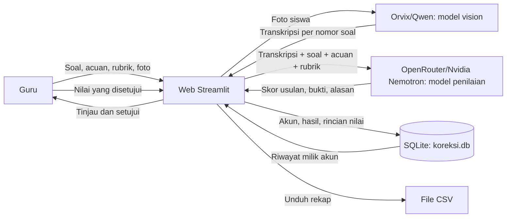

# Ruang Bantu Koreksi

Ruang Bantu Koreksi adalah aplikasi web yang membantu guru meninjau jawaban uraian siswa. Guru memasukkan soal dan acuan jawaban satu kali, lalu mengirim foto lembar jawaban siswa. Aplikasi membaca tulisan pada foto, mengelompokkan jawaban berdasarkan nomor soal, dan memberikan saran nilai beserta alasan serta rincian rubrik. Nilai dari AI tetap berupa saran; guru memeriksa dan menyetujui nilai sebelum hasil disimpan.

Proyek ini dikembangkan oleh **Tim Triboma** untuk mengikuti **LOGICODIX 2026**.

## Tim

- **Nama tim:** Triboma
- **Ketua:** ABIB MUSA CHRIS WARDANA 
- **Anggota:**
  - BAGAS SAPUTRA YUDIANSYAH
  - SATRIA ABDIE WIJAYA PRATAMA
- **Asal Sekolah**: SMAN 3 Probolinggo

## Informasi aplikasi

- **Kategori:** LOGICODIX Web App
- **Nama aplikasi:** Ruang Bantu Koreksi
- **Target pengguna:** Guru Mata Pelajaran Eksak yang perlu memeriksa jawaban uraian dari siswa.
- **Masalah yang diangkat:** Pemeriksaan tugas/ujian uraian membutuhkan waktu, terutama ketika guru mengajar banyak kelas. Jam Pelajaran yang banyak menyebabkan guru tidak sempat mengoreksi ujian. Bahkan dari Bapak Ibu Guru kami yang ditanyai, sampai membawa lembar ujian siswa ke rumah mereka untuk dikoreksi saat di rumah. 
- **Solusi:** Aplikasi menggabungkan transkripsi foto, penilaian berbantuan AI berdasarkan soal, acuan, dan rubrik berbobot, serta persetujuan akhir oleh guru.
- **Tautan demo:** [Tambahkan URL aplikasi yang sudah di-deploy]

## Fitur utama

1. Guru dapat membuat akun dan masuk menggunakan email serta kata sandi.
2. Guru memasukkan identitas tugas, beberapa soal, dan acuan jawaban yang dipakai bersama oleh seluruh siswa.
3. Guru dapat mengatur empat komponen rubrik dan bobotnya. Total bobot aktif harus berjumlah 100%.
4. Foto lembar jawaban dapat dimasukkan melalui unggahan berkas atau kamera. Setiap siswa dapat mengirim satu sampai tiga foto; foto dibaca sebagai satu kumpulan dan jawaban dikelompokkan menurut nomor soal.
5. Model vision mentranskripsikan nama serta jawaban siswa. Teks hasil baca yang tidak terpetakan atau meragukan ditandai agar diperiksa.
6. Model bahasa memberikan skor usulan, alasan, bukti berupa kutipan jawaban, dan rincian skor rubrik untuk setiap soal.
7. Guru meninjau saran AI, menyetujui nilai setiap soal, lalu menyimpan hasil koreksi.
8. Hasil tersimpan dapat dilihat pada halaman riwayat. Aplikasi juga menyediakan unduhan rekap nilai dalam format CSV.

## Teknologi

- **Bahasa pemrograman:** Python
- **Framework aplikasi web:** Streamlit
- **HTTP client:** Requests
- **Database:** SQLite, melalui modul `sqlite3` dari Python
- **API AI:** Orvix untuk transkripsi foto dan OpenRouter untuk penilaian teks
- **Model vision untuk transkripsi:** `orvix/qwen-3.8-omni-flash`
- **Model penilaian teks:** `nvidia/nemotron-3-ultra-550b-a55b:free` melalui OpenRouter
- **Penyimpanan kredensial:** `ORVIX_API_KEY` dan `OPENROUTER_API_KEY`; pada Streamlit Community Cloud, keduanya disimpan di Secrets.
- **Pustaka lain:** modul bawaan Python untuk CSV, JSON, hashing kata sandi, validasi teks, dan pengolahan berkas.

Model gratis dapat mengalami pembatasan atau perubahan ketersediaan dari penyedia. Periksa katalog dan ketentuan OpenRouter sebelum penggunaan atau demo.

## Arsitektur sistem dan alur data



Foto dikirim ke Orvix untuk ditranskripsikan. Teks transkripsi beserta soal, acuan, dan rubrik kemudian dikirim ke OpenRouter untuk memperoleh saran penilaian. Guru tetap memeriksa dan menyetujui nilai akhir.

### Data yang disimpan

Database lokal `koreksi.db` berisi akun, ringkasan koreksi, dan rincian nilai per soal. Kata sandi tidak disimpan sebagai teks biasa; aplikasi menyimpan hash dengan salt. Riwayat ditampilkan per akun dan dibatasi pada 20 koreksi terakhir. Foto lembar jawaban tidak disimpan ke database oleh alur penyimpanan hasil.

## Persiapan dan instalasi

### Memakai aplikasi yang sudah di-deploy

Jika hanya ingin menggunakan aplikasi, buka tautan demo pada bagian Informasi aplikasi. Pengguna tidak perlu membuat atau memasukkan API key. API key untuk aplikasi yang di-deploy disimpan oleh tim pada pengaturan Secrets layanan hosting.

### Menjalankan salinan repositori 

Langkah clone di bawah ini ditujukan untuk pengembang yang ingin menjalankan aplikasi di komputer sendiri atau Codespaces. Untuk menjalankan salinan tersebut, siapkan API key OpenRouter milik sendiri. 

### Persyaratan

- Python 3.10 atau lebih baru.
- Git.
- API key OpenRouter.

### Menjalankan di komputer lokal

1. Clone repositori dan masuk ke folder proyek:

   ```bash
   git clone https://github.com/ygoliberon/logicodix2026-asistenkoreksiuraian.git
   cd logicodix2026-asistenkoreksiuraian
   ```

2. Buat dan aktifkan virtual environment.

   **Windows PowerShell:**

   ```powershell
   python -m venv .venv
   .\.venv\Scripts\Activate.ps1
   ```

   **Linux, macOS, atau Codespaces:**

   ```bash
   python3 -m venv .venv
   source .venv/bin/activate
   ```

3. Pasang dependensi:

   ```bash
   python -m pip install -r requirements.txt
   ```

4. Atur API key Orvix dan OpenRouter di environment terminal. File `.env.example` hanya menunjukkan nama variabel yang diperlukan; aplikasi tidak otomatis membaca file `.env`.

   **PowerShell:**

   ```powershell
   $env:ORVIX_API_KEY="isi_dengan_api_key_orvix_anda"
   $env:OPENROUTER_API_KEY="isi_dengan_api_key_openrouter_anda"

   Contoh Linux atau macOS:

   ```bash
   export ORVIX_API_KEY="isi_dengan_api_key_orvix_anda"
   export OPENROUTER_API_KEY="isi_dengan_api_key_openrouter_anda"
   ```

   Jangan masukkan API key asli ke source code, screenshot, atau GitHub. Jangan mengisi `.env.example` dengan key aktif.

   **Codespaces:** buat Codespaces Secret bernama `OPENROUTER_API_KEY` dan `ORVIX_API_KEY` pada pengaturan repositori atau akun GitHub, lalu mulai ulang Codespace agar secret terbaca. Jangan menulis key ke file yang akan di-commit.

5. Jalankan aplikasi:

   ```bash
   python -m streamlit run app.py
   ```

6. Buka aplikasi di browser.

   - **Komputer lokal:** buka alamat yang ditampilkan Streamlit di terminal, biasanya `http://localhost:8501`.
   - **Codespaces:** buka tab **Ports**, lalu klik tautan port `8501` yang diteruskan ke browser.

7. Coba aplikasi menggunakan berkas contoh di folder `sample_uji_coba`.

   - Masukkan soal dan kunci jawaban dari file `soal_dan_kunci_jawaban`.
   - Unggah foto lembar jawaban `siswa1.png` atau `siswa2.png` untuk menguji pembacaan dan penilaian.
   

### Catatan penyimpanan database

Aplikasi membuat `koreksi.db` di direktori yang sama dengan file utama. SQLite cocok untuk prototipe dan demonstrasi. Penyimpanan lokal pada layanan hosting seperti Streamlit Community Cloud tidak dijamin bertahan setelah aplikasi dihentikan, dibangun ulang, atau dipindahkan. Untuk penggunaan nyata dengan banyak guru, pindahkan data ke layanan database terkelola dan siapkan pencadangan sebelum menyimpan data siswa secara berkelanjutan.

## Akun demo

Aplikasi bisa dicoba tanpa akun namun tidak bisa melihat riwayat koreksi.
Jika ingin menggunakan akun, silahkan gunakan akun demo berikut: 
- **Username:** 
- **Password:**

## Penggunaan AI

AI digunakan untuk dua tugas yang terpisah:

1. **Transkripsi foto:** model vision membaca tulisan tangan, nama siswa, dan nomor soal. Model diminta menyalin isi foto tanpa melengkapi langkah yang tidak terlihat. Foto dapat berisi tulisan yang samar, pecahan, coretan, atau angka yang bentuknya mirip; karena itu hasil OCR harus diperiksa.
2. **Saran penilaian:** model teks menerima hasil transkripsi bersama soal, acuan, dan rubrik. Model memberikan skor usulan, kutipan bukti, alasan, dan rincian rubrik. Guru memeriksa serta menyetujui nilai sebelum hasil disimpan.

> Jawaban, nama, dan foto siswa dapat berisi data pribadi. Aplikasi mengirim foto kepada penyedia model vision dan teks transkripsi kepada OpenRouter untuk diproses. Gunakan data uji atau data yang telah mendapat izin, minimalkan informasi pribadi, dan jangan menganggap saran AI sebagai keputusan nilai final.

## Atribusi dan lisensi aset

- **Streamlit:** framework antarmuka web, [streamlit.io](https://streamlit.io/).
- **Requests:** pustaka HTTP Python, [requests.readthedocs.io](https://requests.readthedocs.io/).
- **OpenRouter:** layanan perantara API model, [openrouter.ai](https://openrouter.ai/).
- **Orvix/Qwen-3.8-omni-flash:** model yang dipakai untuk transkripsi gambar. (https://qwen.ai/blog?id=qwen3.8-omni-flash)
- **NVIDIA Nemotron 3 Ultra:** model yang dipakai untuk saran penilaian teks. https://docs.nvidia.com/nemotron/0.2.0/nemotron/ultra3/mopd.html
- **Aset pada `bahan_gambar/`:** `background.jpg`, `background_terang.jpg`, `element.png`, dan `logo.png` dibuat oleh Tim Triboma menggunakan Canva
- **Soal Ujian, Kunci Jawaban, dan Foto lembar jawaban siswa:** Soal ujian dan kunci jawaban merupakan soal yang dibuat salah satu guru kami. Foto lembar siswa merupakan beberapa lembar jawaban merupakan lembar jawaban asli namun nama yang tertulis diganti dengan nama samaran.
